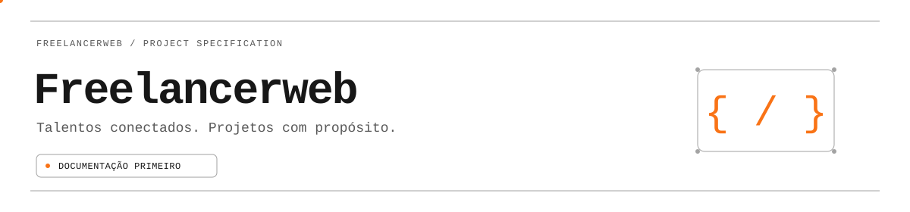
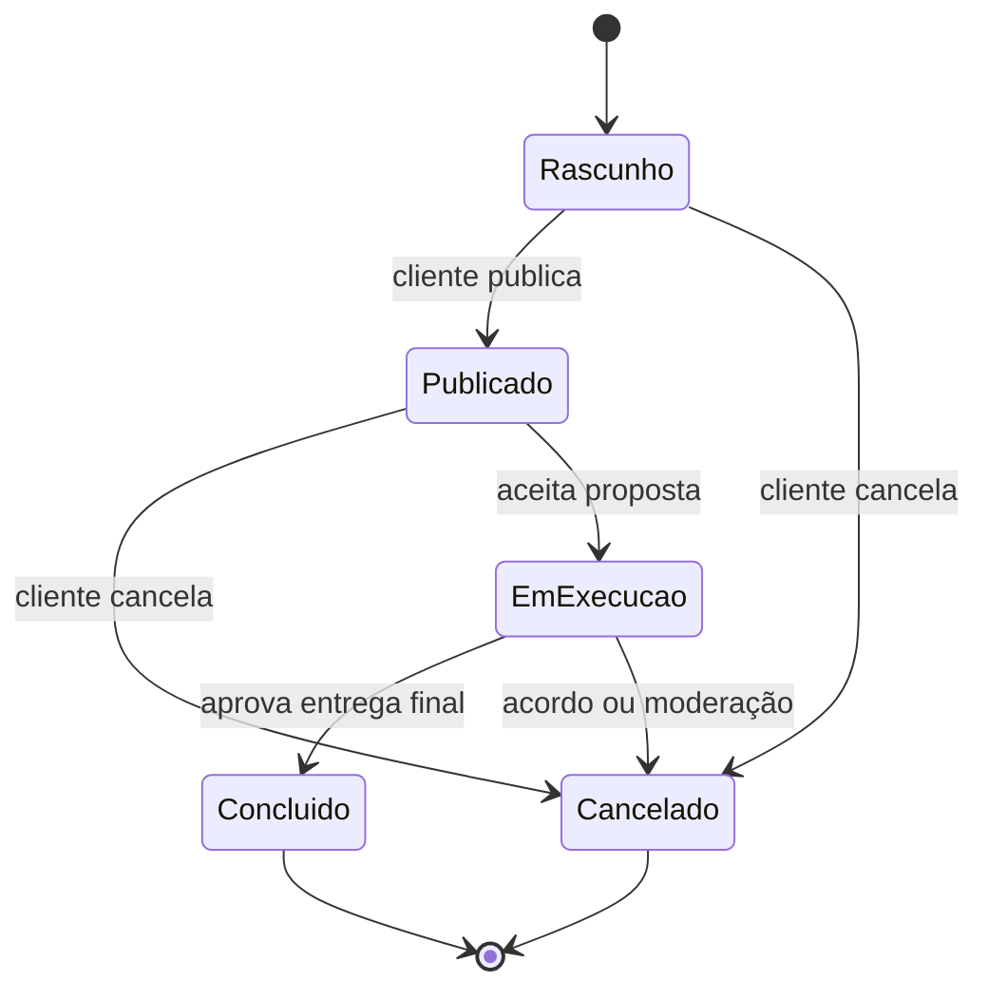
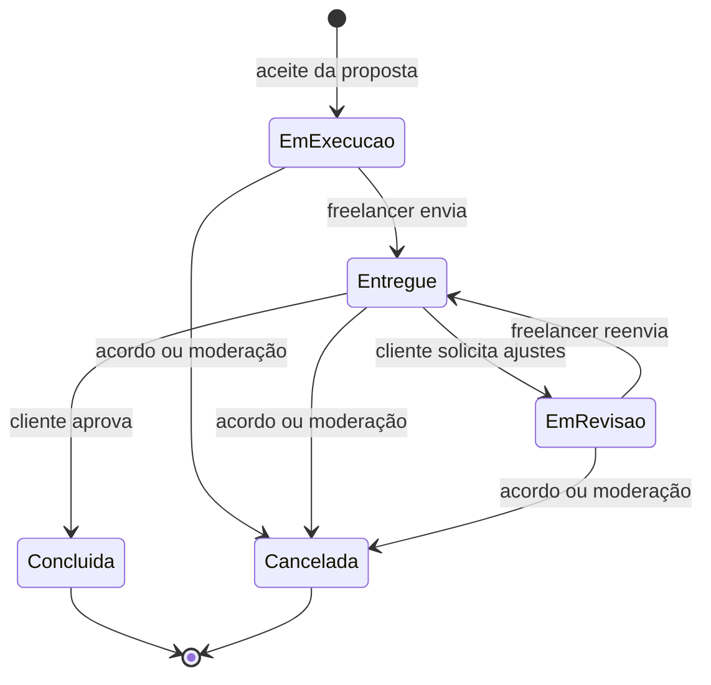
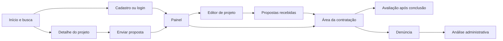
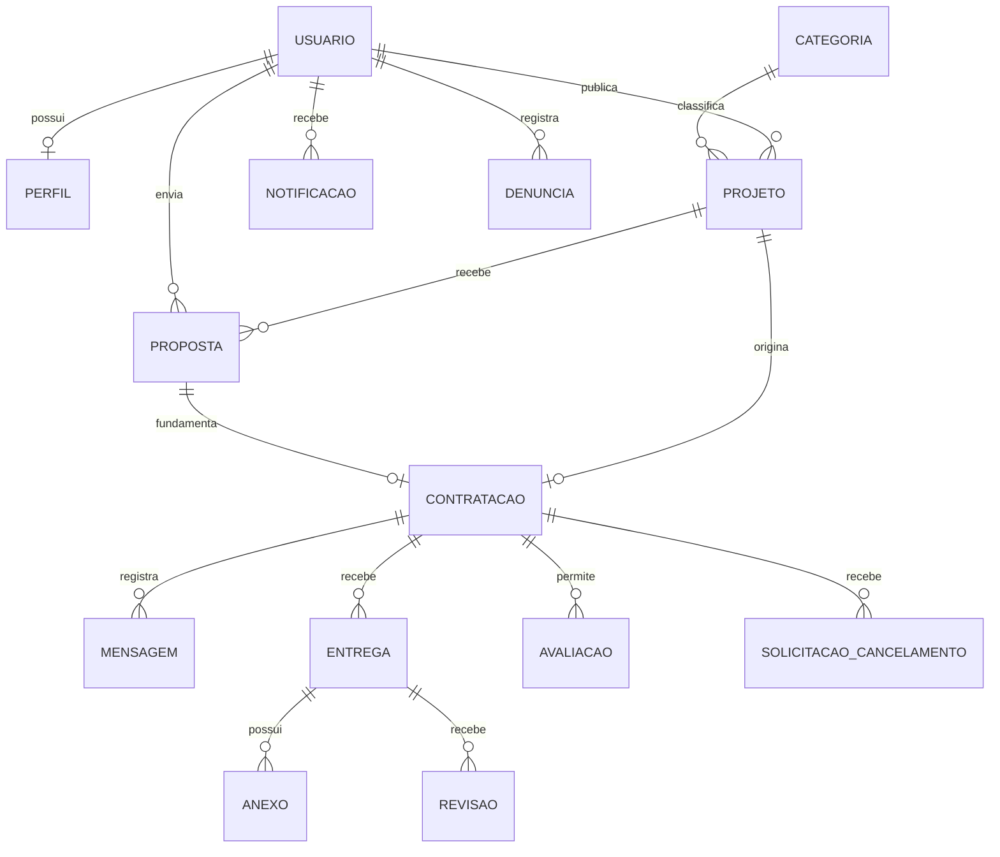

<a id="topo"></a>

<div align="center">



# Freelancerweb · Especificação de software

**Uma plataforma para conectar clientes e profissionais freelancers.**

Este documento define o que o Freelancerweb deverá fazer, quais regras deverá respeitar e como a equipe verificará cada entrega. Ele reúne o escopo da primeira versão, os requisitos, as telas previstas e as decisões técnicas para revisão da equipe e do professor.

<p>
  
  
  
</p>

[Requisitos](#3-requisitos-do-sistema) · [Telas e fluxos](#37-modelagem-das-telas) · [Stack](#4-requisitos-técnicos-do-projeto) · [Backlog](#5-ideias-futuras--backlog)

</div>

> [!IMPORTANT]
> **Documentação primeiro.** Este repositório está na fase de especificação. Os badges indicam decisões e propostas, não funcionalidades implementadas ou resultados de testes.

```text
freelancerweb / especificação do projeto
──────────────────────────────────────────────────────────────
  PRODUTO       Marketplace de serviços freelancers
  MISSÃO        Conectar quem precisa a quem sabe fazer
  FRAMEWORK     Laravel · definido pela equipe
  ENTREGA       Especificação do MVP · em revisão
  PRÓXIMO PASSO Validar os requisitos com a equipe e o professor
──────────────────────────────────────────────────────────────
  > requisitos antes do código_
```

<div align="center">

| `32` REQUISITOS FUNCIONAIS | `18` REQUISITOS DE QUALIDADE | `20` REGRAS DE NEGÓCIO |
|:---:|:---:|:---:|
| O que o produto deve fazer | Como o produto deve funcionar | Condições que o produto deve respeitar |

</div>

## Identidade acadêmica

**Instituto Federal de Educação, Ciência e Tecnologia do Tocantins — Campus Paraíso do Tocantins**

**Curso:** Bacharelado em Sistemas de Informação

**Disciplina:** Linguagens e Técnicas de Programação III

**Professor:** Marcos

**Local e ano:** Paraíso do Tocantins — 2026

**Equipe de desenvolvimento**

- Fernando de Paula Matos
- Vinícius Celestino
- João Francisco
- Gabriel

**Versão do documento:** 0.5 · **Atualização:** 28/10/2026 · **Situação:** em revisão.

Laravel está definido pela equipe. Os limites da primeira versão e as tecnologias complementares ainda precisam de validação, conforme a [seção 6](#6-validação-e-decisões-pendentes).

<p align="center"></p>

## Sumário

### Como ler este documento

| Para entender… | Comece por… |
|---|---|
| A proposta e os limites da primeira versão | [Definição do projeto](#2-definição-do-projeto) |
| O que deve ser desenvolvido e como aceitar a entrega | [Requisitos funcionais](#31-requisitos-funcionais) e [regras de negócio](#33-regras-de-negócio) |
| A qualidade esperada e como medi-la | [Requisitos não funcionais](#32-requisitos-não-funcionais) |
| A navegação, os estados e os dados do sistema | [Estados](#36-estados-e-transições), [telas](#37-modelagem-das-telas) e [modelo de dados](#38-modelo-conceitual-de-dados) |
| As tecnologias previstas | [Requisitos técnicos](#4-requisitos-técnicos-do-projeto) |
| O que falta decidir antes de programar | [Decisões pendentes](#62-propostas-que-precisam-de-revisão) |

**Índice completo:**

1. [Histórico de alterações](#1-histórico-de-alterações)
2. [Definição do projeto](#2-definição-do-projeto)
3. [Requisitos do sistema](#3-requisitos-do-sistema)
4. [Requisitos técnicos do projeto](#4-requisitos-técnicos-do-projeto)
5. [Ideias futuras — backlog](#5-ideias-futuras--backlog)
6. [Validação e decisões pendentes](#6-validação-e-decisões-pendentes)
7. [Referências e origem da documentação](#7-referências-e-origem-da-documentação)
8. [Glossário](#8-glossário)

---

## 1. Histórico de alterações

`01 / HISTÓRICO`

| Data | Versão | Descrição | Validação |
|---|---|---|---|
| 28/10/2026 | 0.5 | Revisão ortográfica e gramatical, padronização da redação e atualização da edição em PDF, com Arial e paginação uniforme. | Revisão pendente pela equipe. |
| 28/10/2026 | 0.4 | Revisão de clareza: guia de leitura, glossário, exemplo de uso, distinção entre MVP e produção e alinhamento das regras. Registro da apresentação atual em SVG animado. | Revisão pendente pela equipe. |
| 27/10/2026 | 0.3 | Paleta laranja, branco, cinza e preto; GIFs locais minimalistas no cabeçalho e divisores. Requisitos preservados. | Revisão pendente pela equipe. |
| 27/10/2026 | 0.2 | Atualização visual: cabeçalho animado, identidade de terminal, badges, navegação e apresentação da stack; requisitos preservados. | Revisão pendente pela equipe. |
| 27/10/2026 | 0.1 | Elaboração da especificação, escopo do MVP, requisitos, regras de negócio, modelagem e proposta técnica em Laravel. | Revisão pendente pela equipe. |

A versão 0.5 preserva os identificadores e as prioridades dos requisitos, com esclarecimentos de redação. A equipe ainda precisa homologar o conteúdo, ou seja, confirmar que ele representa a entrega esperada. Mudanças de escopo deverão atualizar os requisitos e seus critérios de aceite neste arquivo. Os identificadores não devem ser reutilizados para funcionalidades diferentes.

---

## 2. Definição do projeto

`02 / VISÃO DO PRODUTO`

### 2.1 Tema

Marketplace web de serviços freelancers, inspirado no modelo de intermediação de projetos de plataformas como Workana, com identidade própria. O nome provisório do produto é **Freelancerweb**.

### 2.2 Problema e objetivo do software

Clientes precisam encontrar profissionais, comparar propostas e acompanhar entregas. Freelancers precisam apresentar suas competências e encontrar oportunidades com escopo, orçamento e prazo claros. Quando essas atividades ficam dispersas entre mensagens e documentos, torna-se difícil recuperar o que foi combinado e acompanhar o andamento do trabalho.

O Freelancerweb tem como objetivo centralizar a publicação de projetos, o envio de propostas, a seleção de um profissional e o acompanhamento da entrega. A plataforma deverá manter o histórico dos acordos e permitir avaliações vinculadas a trabalhos concluídos.

O público-alvo inicial são pessoas e pequenos negócios que contratam serviços digitais, além de profissionais autônomos de áreas como desenvolvimento, design, redação e marketing. Essas categorias são exemplos iniciais, não uma lista definitiva.

### 2.3 Objetivos específicos e resultado esperado

- Permitir que um cliente publique uma oportunidade com informações suficientes para receber propostas.
- Permitir que um freelancer apresente seu perfil e proponha valor e prazo.
- Registrar a contratação de um único freelancer por projeto.
- Manter comunicação privada e histórico das entregas entre os participantes.
- Permitir avaliações verificáveis e moderação básica de abusos.
- Demonstrar, em ambiente acadêmico, um fluxo completo da publicação à conclusão sem movimentação financeira real.

**Critério de sucesso da primeira versão (MVP):** duas contas distintas deverão completar o fluxo cadastro → projeto publicado → proposta enviada → contratação → entrega → aprovação → avaliação. Uma terceira conta sem vínculo não poderá acessar propostas privadas, mensagens ou anexos da contratação. Todos os requisitos classificados como P0 deverão passar pelos critérios de aceite antes da demonstração final.

### 2.4 Atores e permissões

| Ator | Responsabilidades e acesso |
|---|---|
| Visitante | Consultar projetos publicados e perfis públicos; iniciar cadastro e login. |
| Cliente | Publicar e gerenciar seus projetos, analisar propostas recebidas, contratar, conversar, analisar entregas e avaliar. |
| Freelancer | Manter perfil profissional, buscar projetos, enviar propostas, conversar, realizar entregas e avaliar. |
| Administrador | Gerenciar categorias, analisar denúncias, suspender contas e moderar conteúdo com justificativa e auditoria. |

Uma conta poderá atuar como cliente e freelancer, mas não poderá enviar proposta para seu próprio projeto. A função administrativa será atribuída por procedimento interno; não aparecerá como opção no cadastro público. A troca de contexto na interface não substituirá a verificação de permissões no servidor.

### 2.5 Premissas e limites do MVP

**MVP (produto mínimo viável)** é a primeira versão capaz de demonstrar o fluxo principal completo. Neste projeto, essa entrega será acadêmica, com dados fictícios e sem pagamentos reais.

| Dentro do MVP proposto | Fora do MVP |
|---|---|
| Aplicação web responsiva em português do Brasil. | Aplicativos nativos Android/iOS. |
| Projetos com preço fixo, em reais (BRL). | Contratação por hora, múltiplas moedas e conversão cambial. |
| Um cliente e um freelancer por contratação. | Equipes, agências e múltiplos contratados no mesmo projeto. |
| Registro digital das condições de contratação. | Assinatura eletrônica formal e emissão fiscal. |
| Mensagens persistidas e consulta ao atualizar a tela. | Chat em tempo real, chamadas de voz e vídeo. |
| Entregas e pedidos de revisão com histórico. | Marcos financeiros e pagamentos por etapa. |
| Moderação e cancelamento sem movimentação de dinheiro. | Gateway, carteira, custódia, saques e reembolsos. |

O valor de uma proposta será uma condição registrada do serviço, **não um pagamento processado**. O sistema não deverá exibir saldo, depósito garantido, pagamento aprovado ou qualquer promessa de garantia financeira no MVP. Também não deverá coletar dados de cartão ou conta bancária.

### Exemplo do fluxo principal

Considere um cliente que precisa de uma página de apresentação para seu negócio:

1. **Publicação:** o cliente descreve o trabalho, informa um orçamento de R$ 800 a R$ 1.200 e um prazo desejado de dez dias.
2. **Proposta:** um freelancer oferece realizar o serviço por R$ 1.000 em sete dias corridos.
3. **Contratação:** o cliente aceita a proposta. O sistema registra o escopo, o valor de R$ 1.000 e o prazo de sete dias a partir do aceite.
4. **Execução:** os participantes trocam mensagens e o freelancer registra a entrega.
5. **Análise:** o cliente aprova a entrega ou solicita ajustes. Se pedir ajustes, o freelancer envia uma nova versão.
6. **Conclusão:** após a aprovação, o trabalho é encerrado e cada participante pode avaliar a outra parte.

Os valores ilustram o acordo; o sistema não movimenta dinheiro. O prazo desejado do projeto é uma referência para propostas. O prazo da contratação é o prazo efetivamente aceito, e uma revisão não o prorroga automaticamente.

### 2.6 Mapa de módulos proposto

| ID do módulo | Responsabilidade | Depende de |
|---|---|---|
| `identidade` | Contas, autenticação, permissões e suspensão. | — |
| `perfis` | Apresentação profissional e portfólio. | `identidade` |
| `projetos` | Categorias, publicação e busca de oportunidades. | `identidade` |
| `propostas` | Candidaturas, valores e prazos. | `perfis`, `projetos` |
| `contratacoes` | Aceite, condições acordadas e estados do trabalho. | `propostas` |
| `colaboracao` | Mensagens, entregas e revisões. | `contratacoes` |
| `reputacao` | Avaliações de trabalhos concluídos. | `colaboracao` |
| `moderacao` | Denúncias, medidas administrativas e auditoria. | Módulos de conteúdo e `identidade` |

Esse mapa é uma proposta de divisão de responsabilidades, não a criação de microsserviços. Notificações serão um recurso transversal acionado por eventos dos módulos. A implementação será planejada depois da revisão da documentação.

<p align="center"></p>

## 3. Requisitos do sistema

`03 / REQUISITOS`

### Convenções

- **RF (requisito funcional):** ação que o sistema deve permitir, como enviar uma proposta.
- **RNF (requisito não funcional):** condição de qualidade, como tempo de resposta e segurança.
- **RN (regra de negócio):** restrição do funcionamento, como impedir uma proposta para o próprio projeto.
- **Critério de aceite:** resultado observável que permite verificar se um requisito foi atendido.
- **UC:** caso de uso; **CA:** cenário de aceite; **T:** tela; **BL:** item do backlog (lista de evoluções).
- **P0 — essencial:** necessário para o MVP; **P1 — complementar:** pode ficar para uma segunda entrega; **P2 — futuro:** fora do MVP.
- Cada critério de aceite descreve comportamento verificável. Todos os requisitos desta seção estão **especificados, ainda não implementados**.
- Os limites numéricos são propostas para tornar a especificação testável e deverão ser revistos com a equipe.

### 3.1 Requisitos funcionais

São **30 requisitos P0** para o MVP e **dois P1**, RF006 e RF026, reservados para uma entrega complementar. Os requisitos estão agrupados pelo fluxo de uso; cada linha deve ser lida junto das regras citadas nas seções seguintes.

#### 3.1.1 Cadastro, acesso e perfil

| ID | Prioridade | Requisito | Critério de aceite |
|---|---|---|---|
| RF001 | P0 | O sistema deve permitir cadastro com nome, e-mail, senha, confirmação de senha e aceite da versão vigente dos termos e do aviso de privacidade. | Dados válidos criam uma conta; e-mail duplicado, senha divergente ou aceite ausente impedem a criação e exibem orientação. O cadastro nunca concede função administrativa. |
| RF002 | P0 | O sistema deve permitir login e logout. | Credenciais válidas iniciam uma sessão; falhas de autenticação exibem mensagem genérica; o logout invalida a sessão e impede sua reutilização. |
| RF003 | P0 | O sistema deve permitir recuperação de senha por e-mail. | Link de uso único expira em 60 minutos; após redefinição, a senha anterior deixa de autenticar e sessões anteriores são revogadas. A resposta à solicitação não revela se o e-mail existe. |
| RF004 | P0 | O sistema deve verificar a titularidade do e-mail antes de publicar projeto, enviar proposta ou contratar. | Conta não verificada pode navegar, mas as ações restritas são recusadas; link válido marca a conta como verificada e não pode verificar outra conta. |
| RF005 | P0 | O sistema deve permitir edição do próprio perfil profissional. | Usuário altera nome público, título profissional, biografia e até 20 habilidades; tentativas de editar o perfil de outro usuário são recusadas. E-mail e dados privados não aparecem no perfil público. |
| RF006 | P1 | O sistema deve permitir cadastrar itens de portfólio com título, descrição e link HTTPS. | O autor pode criar, editar e remover itens; links com protocolos executáveis são rejeitados; visitante visualiza apenas itens públicos. |
| RF007 | P0 | O sistema deve apresentar perfil público com habilidades, quantidade de avaliações e média das notas recebidas. | Perfil sem avaliação exibe “Ainda sem avaliações”; a média considera somente avaliações publicadas de contratações concluídas. |

#### 3.1.2 Projetos e descoberta

| ID | Prioridade | Requisito | Critério de aceite |
|---|---|---|---|
| RF008 | P0 | O sistema deve permitir criar rascunho e editar projeto conforme RN003. | Cliente informa título, descrição, categoria, habilidades, orçamento mínimo/máximo e prazo desejado. Rascunho é privado; projeto publicado só pode ser editado antes de receber a primeira proposta. |
| RF009 | P0 | O sistema deve permitir publicar um rascunho válido. | Com e-mail verificado e campos válidos, o projeto passa para publicado e aparece na busca; campos ausentes ou orçamento inválido impedem a publicação. |
| RF010 | P0 | O sistema deve listar e filtrar projetos publicados por texto, categoria, habilidade e faixa de orçamento. | O resultado deve atender a todos os filtros selecionados; resultados são paginados em 20 itens, ordenados do mais recente ao mais antigo, com desempate por ID. Busca sem resultados apresenta orientação para alterar ou limpar os filtros. |
| RF011 | P0 | O sistema deve exibir detalhes públicos de projeto disponível. | Visitante vê descrição, habilidades, faixa de orçamento, prazo desejado e perfil público do cliente; não vê propostas ou mensagens. A listagem pública inclui apenas projetos publicados e visíveis; rascunhos, projetos em execução, concluídos, cancelados ou ocultos pela moderação ficam fora dela. |
| RF012 | P0 | O sistema deve permitir cancelar projeto ainda não contratado. | Apenas o autor pode cancelar; a operação registra motivo, retira o projeto da busca e encerra propostas pendentes, sem apagar o histórico. |
| RF013 | P0 | O sistema deve apresentar painel com os projetos, propostas e contratações do usuário. | Cliente vê seus projetos e propostas recebidas; freelancer vê suas candidaturas e contratações; os totais e filtros correspondem aos registros acessíveis à conta. |

#### 3.1.3 Propostas e contratação

| ID | Prioridade | Requisito | Critério de aceite |
|---|---|---|---|
| RF014 | P0 | O sistema deve permitir enviar proposta com apresentação, valor e prazo em dias corridos. | Freelancer verificado, com título profissional, biografia e ao menos uma habilidade preenchidos, envia uma proposta a projeto publicado de outro usuário; o sistema recusa propostas duplicadas, de contas suspensas, com valor inválido ou para projetos indisponíveis. |
| RF015 | P0 | O sistema deve permitir editar ou retirar proposta pendente. | Somente o autor pode alterar uma proposta ainda pendente e de projeto publicado; retirada mantém histórico e impede posterior aceite. |
| RF016 | P0 | O sistema deve permitir ao cliente comparar propostas do próprio projeto. | A listagem mostra autor, valor, prazo e apresentação; terceiros e outros candidatos não conseguem ler essas propostas, inclusive por URL direta. |
| RF017 | P0 | O sistema deve permitir ao cliente aceitar uma proposta pendente e registrar a contratação. | O aceite cria uma única contratação, preserva as condições aceitas e muda o projeto para em execução; as demais propostas pendentes são recusadas. Duas solicitações simultâneas não criam duas contratações. |
| RF018 | P0 | O sistema deve permitir ao cliente recusar proposta pendente. | Somente o dono do projeto pode recusar; o estado passa a recusada e o autor vê o resultado no painel. Proposta já aceita não pode ser recusada por essa ação. |
| RF019 | P0 | O sistema deve exibir as condições e o histórico da contratação aos participantes. | Cliente e freelancer consultam escopo acordado, valor, prazo, data de aceite, estados e eventos; alterações posteriores no perfil ou projeto não alteram o acordo registrado. |

#### 3.1.4 Comunicação, entrega e reputação

| ID | Prioridade | Requisito | Critério de aceite |
|---|---|---|---|
| RF020 | P0 | O sistema deve permitir troca de mensagens de texto entre os participantes de uma contratação ativa. | Mensagem não vazia, de até 5.000 caracteres, é persistida com remetente e horário; terceiros recebem acesso negado, salvo análise administrativa vinculada a uma denúncia, conforme RN016. Após encerramento, a conversa fica somente para leitura. |
| RF021 | P0 | O sistema deve permitir que o freelancer registre uma entrega com descrição e até cinco anexos. | Apenas o contratado pode entregar em execução ou em revisão; o sistema registra uma nova versão, preserva as anteriores e muda o estado para entregue. |
| RF022 | P0 | O sistema deve permitir que o cliente solicite revisão de uma entrega. | Apenas o contratante solicita revisão de entrega pendente de análise, com justificativa obrigatória; estado passa a em revisão e o histórico permanece acessível. |
| RF023 | P0 | O sistema deve permitir ao cliente aprovar a entrega e concluir a contratação. | Aprovar uma entrega pendente registra data de conclusão e encerra o projeto; repetir a ação não duplica eventos nem avaliações. Não há conclusão automática por tempo no MVP. |
| RF024 | P0 | O sistema deve permitir uma avaliação de cada participante sobre a outra parte após a conclusão. | Nota inteira entre 1 e 5 e comentário opcional de até 1.000 caracteres; avaliação própria, duplicada ou anterior à conclusão é recusada. |
| RF025 | P0 | O sistema deve gerar notificações internas de proposta recebida, aceite/recusa, entrega, revisão, conclusão e cancelamento. | O destinatário vê evento e vínculo para o recurso autorizado; marcar como lida não afeta notificações de outras contas. Reprocessar o mesmo evento não duplica a notificação. |
| RF026 | P1 | O sistema deve enviar por e-mail os eventos de contratação, entrega e conclusão conforme preferência do usuário. | Desativar avisos opcionais impede novos envios desse tipo; falha no envio não desfaz a ação principal e permite nova tentativa sem duplicação. |
| RF027 | P0 | O sistema deve permitir solicitação de cancelamento de uma contratação ativa. | Participante informa motivo; a contraparte pode aceitar ou recusar. Aceite cancela projeto e contratação; recusa mantém o estado anterior e permite denúncia para moderação. Sem resposta, nada é cancelado automaticamente. |

#### 3.1.5 Administração e moderação

| ID | Prioridade | Requisito | Critério de aceite |
|---|---|---|---|
| RF028 | P0 | O sistema deve permitir denunciar projeto, perfil, avaliação ou a própria contratação. | Usuário autenticado informa motivo e descrição; recebe protocolo e acompanha situação. Denúncia de contratação privada exige participação nela. |
| RF029 | P0 | O sistema deve permitir ao administrador analisar denúncias e registrar decisão. | O administrador encerra a denúncia como procedente ou improcedente, com justificativa; a decisão preserva o histórico, registra eventual ocultação de conteúdo ou cancelamento administrativo e notifica os envolvidos. |
| RF030 | P0 | O sistema deve permitir ao administrador suspender e reativar contas. | Suspensão exige motivo, revoga sessões e impede novas ações autenticadas; reativação é auditada. Trabalhos ativos são encaminhados à moderação, sem conclusão ou exclusão automática. |
| RF031 | P0 | O sistema deve permitir ao administrador cadastrar, renomear e desativar categorias. | Nome é único; categoria desativada não pode ser escolhida em novos projetos, mas continua identificável no histórico dos existentes. |
| RF032 | P0 | O sistema deve registrar operações administrativas e alterações relevantes de estado. | Registro contém ator, ação, objeto, data e justificativa quando aplicável; usuários comuns não podem editar ou apagar a trilha. |

### 3.2 Requisitos não funcionais

**Como interpretar as metas:** os requisitos desta seção descrevem a qualidade esperada. A execução dos testes depende da etapa do projeto:

| Etapa | O que verificar |
|---|---|
| Desenvolvimento e demonstração acadêmica | Funcionalidades, permissões, integridade, arquivos, responsividade e testes automatizados. Usar os cenários descritos em cada RNF. |
| Homologação (ambiente de validação) | Medir RNF001 e RNF002 nas condições declaradas; testar compatibilidade e acessibilidade. Registrar resultados e limitações do ambiente. |
| Antes de abrir o sistema ao público | Aplicar as configurações de produção de RNF006 e RNF014, aprovar o procedimento de privacidade de RNF011 e validar restauração de backup de RNF012. |
| Operação pública futura | Medir a disponibilidade mensal de RNF013 e manter backups e monitoramento. Essas medições não são exigidas de uma aplicação que ainda não está publicada. |

**Percentil 95 (p95)** significa que pelo menos 95% das requisições devem ficar dentro do tempo indicado. **LCP** mede o tempo de exibição do maior conteúdo visível; **CLS** mede mudanças inesperadas de posição dos elementos. As diretrizes **WCAG 2.2 AA** são a referência de acessibilidade adotada.

As metas abaixo são critérios de qualidade para o produto futuro, não resultados já medidos. O cenário de referência de desempenho será uma base com 10.000 projetos e 50 usuários virtuais simultâneos em homologação de 2 vCPU e 4 GB de RAM, com configuração e dados registrados no relatório de teste.

| ID | Categoria | Requisito e meta | Método de verificação |
|---|---|---|---|
| RNF001 | Desempenho | Busca, detalhes e painel devem responder em até 800 ms no percentil 95 das requisições, com taxa de erro inferior a 1%, em teste de 10 minutos no cenário de referência; uploads e terceiros são excluídos. | Teste de carga com relatório de percentis, erros e consultas. |
| RNF002 | Carregamento | Página pública deve atingir LCP de até 2,5 s e CLS de até 0,1 em avaliação móvel de laboratório, usando mediana de cinco execuções e perfil de rede registrado. | Auditoria de página publicada em homologação, com ferramenta e condições registradas. |
| RNF003 | Responsividade | Fluxos essenciais devem funcionar em larguras de 360, 768 e 1280 px, sem rolagem horizontal da página. | Inspeção das telas e realização do fluxo completo nas três larguras. |
| RNF004 | Acessibilidade | Fluxos essenciais devem permitir teclado, foco visível, rótulos de campos, mensagens associadas e contraste mínimo de 4,5:1 para texto normal. WCAG 2.2 AA será a referência de avaliação. | Verificação automatizada e manual; zero barreiras críticas no fluxo principal. |
| RNF005 | Credenciais | O sistema deve exigir senhas com, no mínimo, 12 caracteres, permitir senhas com pelo menos 64 caracteres e armazená-las somente como hash adaptativo, usando o mecanismo do Laravel. | Testes de validação e inspeção da persistência; ausência de senha em texto puro e logs. |
| RNF006 | Sessão e transporte | Em produção, usar HTTPS, cookies de sessão Secure/HttpOnly/SameSite, renovação de sessão no login e proteção CSRF em operações autenticadas via formulário. | Testar cabeçalhos, troca de sessão e rejeição de requisição mutável sem token válido. |
| RNF007 | Autorização | Toda leitura ou alteração de recurso privado deve conferir papel, vínculo e estado no servidor; identificadores enviados pelo navegador não são prova de autorização. | Testes com proprietário, participante, terceiro e conta suspensa; negar acesso indevido mesmo por URL direta. |
| RNF008 | Abuso | O sistema deve limitar o login a cinco tentativas por minuto por combinação de identificador e IP, e a recuperação de senha a três solicitações por hora por identificador. | Ao exceder os limites, o sistema deve exibir um aviso e aplicar bloqueio temporário sem revelar a existência da conta. |
| RNF009 | Integridade | Aceite de proposta e transições de contratação devem ser atômicos; cada projeto deve ter no máximo uma contratação, inclusive sob concorrência. | Testes de integração, transação e duas requisições simultâneas; restrição de unicidade no banco. |
| RNF010 | Uploads | Entregas devem aceitar apenas PDF, PNG e JPEG de até 10 MB por arquivo; validar conteúdo/MIME, tamanho e extensão, renomear arquivos e armazenar de forma privada. | Rejeitar arquivo executável, extensão enganosa, arquivo acima do limite e download sem permissão. |
| RNF011 | Privacidade | Coletar somente os dados necessários; não publicar e-mail, hash de senha, IP ou registros privados. Definir procedimento de solicitação de acesso e exclusão antes de operação pública. | Revisão das respostas e telas; ensaio documentado de solicitação e política de retenção aprovada. |
| RNF012 | Recuperação | Antes de produção, executar backup diário do banco e anexos, com meta de perda máxima de 24 h e restauração em até 4 h. | Restaurar cópia em ambiente isolado e conferir registros e anexos; não basta constatar que o backup existe. |
| RNF013 | Disponibilidade | Quando houver operação pública, meta mensal de 99% de disponibilidade, medida por sondagem externa a cada cinco minutos. | Relatório mensal; ambiente local acadêmico não é evidência dessa meta. |
| RNF014 | Observabilidade | Erros devem registrar identificador de correlação, contexto técnico e horário, sem senhas, tokens ou corpo de mensagens privadas; produção não deve exibir stack trace. | Provocar falha controlada e conferir resposta pública e log restrito. |
| RNF015 | Manutenibilidade | Separar apresentação, validação, autorização e regras de negócio; mudanças de esquema devem usar migrations versionadas. | Revisão de código e instalação do banco em ambiente vazio. |
| RNF016 | Testabilidade | Cada RF P0 deve ter ao menos um cenário verificável associado; permissões, contratação e estados exigem testes automatizados de sucesso e falha. | Matriz de rastreabilidade e suíte sem falhas antes da entrega. |
| RNF017 | Compatibilidade | Fluxos P0 devem funcionar nas duas versões estáveis mais recentes de Chrome, Edge e Firefox disponíveis na homologação. | Registrar versões exatas e executar o roteiro de aceite em cada navegador. |
| RNF018 | Localização | Interface em pt-BR, dinheiro em BRL, datas exibidas no fuso America/Sao_Paulo e persistência temporal em UTC. | Conferir formatação monetária e conversão de datas, inclusive em mudança de dia. |

### 3.3 Regras de negócio

Estas regras complementam os requisitos funcionais. Elas definem quem pode agir, em qual estado e com quais restrições.

| ID | Regra |
|---|---|
| RN001 | E-mail deve ser único após normalização definida pelo sistema; uma conta pode contratar e prestar serviços, mas não negociar consigo mesma. |
| RN002 | É necessário ter uma conta ativa para publicar projetos, enviar propostas, contratar e executar ações privadas. Publicar, propor e contratar também requerem e-mail verificado. Enviar proposta exige título profissional, biografia e ao menos uma habilidade no perfil. |
| RN003 | Projeto só recebe propostas enquanto publicado. O autor pode editar conteúdo até receber a primeira proposta; depois, pode cancelar e publicar outro projeto, preservando o anterior. |
| RN004 | Cada par projeto/freelancer possui uma única proposta no MVP. Editar é permitido enquanto pendente; retirada ou recusa é terminal, sem reenvio para o mesmo projeto. |
| RN005 | Os orçamentos mínimo e máximo são positivos, e o valor mínimo não supera o máximo. Proposta pode estar fora da faixa estimada, mas a divergência deve aparecer ao cliente antes do aceite. |
| RN006 | Os valores monetários são armazenados como números inteiros em centavos, nunca como números de ponto flutuante. Limite proposto de R$ 0,01 a R$ 1.000.000,00 por valor. Prazo da proposta: de 1 a 365 dias corridos. |
| RN007 | Aceitar proposta cria uma contratação única por projeto, com cópia do escopo, valor, participantes e prazo aceitos. A data prevista é calculada a partir do instante de aceite mais o prazo acordado. |
| RN008 | Aceite e recusa das demais propostas ocorrem na mesma transação. Se houver falha, não pode existir contratação parcial ou projeto em estado incompatível. |
| RN009 | Apenas o freelancer contratado registra entrega; apenas o cliente contratante aprova ou solicita revisão. Entrega não significa conclusão nem pagamento. |
| RN010 | Revisões exigem justificativa e geram histórico. Quantidade de revisões não é limitada automaticamente no MVP; conflito de escopo deve ser encaminhado à moderação. |
| RN011 | Conclusão ocorre somente após aprovação explícita do cliente. Atraso gera indicação visual, mas não cancelamento, aprovação ou multa automática. |
| RN012 | Avaliação exige contratação concluída, é dirigida à outra parte e é única por autor/contratação. A média usa notas publicadas, com uma casa decimal e quantidade de avaliações. |
| RN013 | Avaliações ficam públicas após envio e não são editáveis pelo autor no MVP. Administrador pode ocultá-las por denúncia procedente, com motivo, sem alterar o texto em nome do autor. |
| RN014 | Cancelamento antes do aceite é decisão do cliente. Depois do aceite, exige concordância da contraparte ou decisão administrativa justificada; projeto cancelado não é reaberto no MVP. |
| RN015 | Uma solicitação de cancelamento pendente bloqueia novas entregas, revisões e conclusão até ser aceita, recusada ou retirada pelo solicitante. Mensagens permanecem disponíveis enquanto a contratação estiver ativa. |
| RN016 | Somente participantes podem ler mensagens e anexos privados. Administrador só acessa esse conteúdo quando necessário à denúncia vinculada, com registro de acesso; função administrativa não concede leitura irrestrita. |
| RN017 | Suspensão não apaga projetos, mensagens ou acordos. Conteúdo público da conta é ocultado e contratações abertas são encaminhadas à moderação; a contraparte mantém acesso ao próprio histórico. |
| RN018 | Categorias vinculadas a projetos são desativadas, não excluídas fisicamente. Projetos, propostas e contratações com histórico também não são apagados por ações comuns da interface. |
| RN019 | Exclusão/anonimização de conta e retenção de registros terão política própria a validar antes de uso real, sem presumir retenção eterna ou destruição imediata de registros de terceiros. |
| RN020 | O MVP não cobra comissão, não processa pagamentos e não promete proteção financeira. Modelo de receita e meios de pagamento pertencem ao backlog. |

### 3.4 Validação dos principais dados

| Campo | Validação proposta |
|---|---|
| Nome público | Obrigatório, entre 2 e 100 caracteres. |
| E-mail | Obrigatório, formato válido e até 254 caracteres; confirmação por link. |
| Senha | Mínimo de 12 caracteres, confirmação no cadastro; nunca exibida após envio. |
| Título de projeto | Entre 10 e 120 caracteres. |
| Descrição de projeto | Entre 50 e 10.000 caracteres, tratada como texto sem HTML executável. |
| Categoria e habilidades | Uma categoria ativa e de 1 a 10 habilidades por projeto. |
| Apresentação da proposta | Entre 50 e 3.000 caracteres. |
| Orçamento, valor e prazo | Regras RN005 e RN006; prazo desejado do projeto também entre 1 e 365 dias. |
| Descrição de entrega | Entre 10 e 3.000 caracteres; anexos opcionais conforme RNF010. |
| Justificativa de revisão/cancelamento/denúncia | Entre 10 e 2.000 caracteres. |
| Biografia e título profissional | Até 2.000 e 100 caracteres, respectivamente. |

Validações deverão ocorrer no servidor. A validação no navegador serve como auxílio e não deve ser a única proteção. Erros devem preservar campos não sensíveis preenchidos e indicar como corrigir os dados.

### 3.5 Casos de uso principais

| Caso | Ator | Pré-condição | Fluxo principal | Exceção e resultado |
|---|---|---|---|---|
| UC001 — Publicar projeto | Cliente | Conta ativa e verificada. | Criar rascunho → preencher dados → revisar → publicar. | Dados inválidos mantêm rascunho; sucesso disponibiliza oportunidade. |
| UC002 — Enviar proposta | Freelancer | Perfil preenchido, conta ativa/verificada e projeto de outra pessoa publicado. | Buscar → abrir detalhes → informar apresentação, valor e prazo → enviar. | Duplicidade ou indisponibilidade impede envio; sucesso cria proposta pendente. |
| UC003 — Contratar freelancer | Cliente | Dono do projeto e proposta pendente. | Comparar → selecionar → revisar condições → confirmar aceite. | Concorrência ou estado alterado exige atualizar tela; sucesso gera uma contratação. |
| UC004 — Entregar e concluir | Participantes | Contratação em execução, sem cancelamento pendente. | Freelancer entrega → cliente analisa → aprova → partes avaliam. | Cliente pode pedir revisão; nova entrega preserva versões anteriores. |
| UC005 — Cancelar trabalho ativo | Participante | Contratação não encerrada. | Solicitar com motivo → contraparte analisa → aceita. | Recusa restaura a possibilidade de execução e permite encaminhar conflito à moderação. |
| UC006 — Moderar denúncia | Administrador | Denúncia aberta e permissão administrativa. | Consultar contexto autorizado → analisar → justificar decisão → aplicar medida → notificar. | Evidência insuficiente permite encerrar como improcedente, preservando histórico. |

#### Cenários detalhados de aceite

**CA001 — Cadastro duplicado (RF001, RN001)**

Dado um e-mail já cadastrado, quando uma nova inscrição utiliza o mesmo endereço normalizado, então nenhuma segunda conta é criada e o formulário informa que não foi possível concluir o cadastro.

**CA002 — Acesso indevido (RF016, RF020, RNF007)**

Dado um usuário sem vínculo com o projeto ou a contratação, quando tenta abrir propostas, mensagens ou anexos diretamente por identificador, então recebe acesso negado ou recurso não encontrado, sem conteúdo privado na resposta.

**CA003 — Contratação simultânea (RF017, RN007, RN008)**

Dadas duas propostas pendentes, quando duas requisições tentam aceitá-las ao mesmo tempo, então apenas uma cria contratação e a outra recebe conflito de estado; o banco contém uma contratação e uma proposta aceita.

**CA004 — Revisão com histórico (RF021, RF022)**

Dada uma entrega enviada, quando o cliente solicita revisão e o freelancer entrega novamente, então ambas as versões continuam acessíveis e a contratação volta para entregue, aguardando aprovação.

**CA005 — Avaliação indevida (RF024, RN012)**

Dada uma contratação em execução ou cancelada, quando um participante tenta avaliar, então a avaliação é recusada. Depois da conclusão, um segundo envio do mesmo autor também é recusado.

**CA006 — Cancelamento acordado (RF027, RN014, RN015)**

Dada uma solicitação pendente, quando a contraparte aceita, então projeto e contratação tornam-se cancelados e nenhuma nova entrega é permitida. Se recusar, o estado anterior é preservado e a execução pode continuar.

### 3.6 Estados e transições

**Projeto** é a oportunidade publicada pelo cliente. **Proposta** é a oferta de um freelancer. **Contratação** é o acordo criado quando uma proposta é aceita.

O projeto permanece **em execução** enquanto a contratação estiver em execução, entregue ou em revisão. Ele só muda para concluído após aprovação do cliente, ou para cancelado após o procedimento de cancelamento. Assim, “entregue” significa que há trabalho aguardando análise, não que o projeto terminou.

#### Projeto



A visibilidade por moderação é um atributo separado do estado do projeto. Ocultar conteúdo impede descoberta pública e novas candidaturas, mas não apaga o histórico nem altera automaticamente o estado da contratação.

#### Contratação



Além do projeto e da contratação, existem dois ciclos independentes:

| Registro | Estado inicial | Possíveis estados finais | Observação |
|---|---|---|---|
| Proposta | Pendente | Aceita, recusada, retirada ou encerrada | “Encerrada” significa que o projeto foi cancelado antes de contratar. |
| Solicitação de cancelamento | Pendente | Aceita, recusada ou retirada | Mantém o estado da contratação até a decisão, mas bloqueia entregas, revisões e conclusão conforme RN015. |

Só pode existir uma solicitação de cancelamento pendente por contratação. Ao recusá-la ou retirá-la, os bloqueios são removidos; ao aceitá-la, projeto e contratação são cancelados. Registros em estados finais não podem ser editados.

### 3.7 Modelagem das telas

Esta seção apresenta a navegação e os esboços das telas do sistema. Os wireframes são modelos de baixa fidelidade para orientar o desenvolvimento.

| Tela | Conteúdo e ações | Acesso | RF relacionados |
|---|---|---|---|
| T01 — Início e busca | Apresentação, busca, filtros, lista paginada e chamada para publicar projeto. | Público | RF010, RF011 |
| T02 — Cadastro e acesso | Cadastro, login, recuperação de senha e verificação de e-mail. | Público/conta não verificada | RF001–RF004 |
| T03 — Perfil | Nome público, título, biografia, habilidades, reputação e portfólio quando disponível. | Público; edição pelo titular | RF005–RF007 |
| T04 — Painel | Alternância entre contratar e trabalhar, contadores, projetos, propostas, contratos e notificações. | Autenticado | RF013, RF025 |
| T05 — Editor de projeto | Campos, validação, salvar rascunho, prévia e publicar. | Cliente proprietário | RF008, RF009, RF012 |
| T06 — Detalhe de projeto | Escopo, categoria, habilidades, orçamento, prazo, cliente e botão de proposta. | Público conforme estado | RF011, RF014 |
| T07 — Formulário de proposta | Apresentação, valor, prazo e confirmação; editar/retirar se pendente. | Freelancer autorizado | RF014, RF015 |
| T08 — Propostas recebidas | Comparação, acesso ao perfil, recusa e revisão das condições antes de contratar. | Cliente proprietário | RF016–RF018 |
| T09 — Área da contratação | Resumo do acordo, estado, mensagens, entregas versionadas e ações conforme papel. | Participantes | RF019–RF023, RF027 |
| T10 — Avaliação | Nota, comentário, identificação da contraparte e confirmação. | Participantes após conclusão | RF024 |
| T11 — Denúncia | Tipo, motivo, descrição, protocolo e situação. | Autenticado autorizado | RF028 |
| T12 — Administração | Fila de denúncias, categorias, suspensão, decisões e auditoria. | Administrador | RF029–RF032 |

#### Navegação principal



#### Wireframe — busca de projetos

```text
+------------------------------------------------------------+
| Freelancerweb                 Encontrar projetos | Entrar  |
+------------------------------------------------------------+
| Encontre um projeto para suas habilidades                   |
| [Buscar por título ou descrição________________] [Buscar]   |
+-------------------+----------------------------------------+
| Filtros           | Resultados: 24 projetos                 |
| Categoria [v]     | [Título do projeto]                    |
| Habilidade [v]    | Resumo, habilidades, orçamento e prazo  |
| Orçamento         | Cliente                      [Detalhes] |
| [mín.] [máx.]     |----------------------------------------|
| [Aplicar filtros] | Próximo projeto...                     |
| [Limpar]          | [Anterior]  Página 1 de 2  [Próxima]    |
+-------------------+----------------------------------------+
```

#### Wireframe — contratação

```text
+------------------------------------------------------------+
| Painel > Contratação #ID                      Estado atual  |
+------------------------------------------------------------+
| Projeto | Cliente | Freelancer | Valor acordado | Prazo     |
| Aviso: esta plataforma não processa pagamentos no MVP.      |
+----------------------------------+-------------------------+
| Conversa privada                 | Entregas                |
| Nome, data e mensagem            | Versão, data e anexos   |
| ...                              | Histórico de revisões   |
| [Escrever mensagem____________]  |                         |
| [Enviar]                         | Ações do papel atual:   |
|                                  | [Enviar entrega] OU     |
|                                  | [Aprovar] [Pedir revisão]|
+----------------------------------+-------------------------+
| [Solicitar cancelamento] [Denunciar]                        |
+------------------------------------------------------------+
```

**Estados de interface obrigatórios:** carregamento, vazio, sucesso, validação, erro recuperável, sessão expirada, acesso negado e conflito por atualização concorrente. Ações de contratação, cancelamento e suspensão devem exigir confirmação com resumo das consequências. No celular, filtros devem poder ser recolhidos e os blocos apresentados em uma coluna. Valores e identidades dos wireframes são ilustrativos.

### 3.8 Modelo conceitual de dados

O modelo identifica quais informações precisam ser armazenadas e como se relacionam. Ele orientará o banco de dados; não representa tabelas já criadas.

| Entidade | Dados principais | Restrições essenciais |
|---|---|---|
| Usuário | Nome, e-mail, hash de senha, verificação, situação e papel administrativo. | E-mail único; privilégio administrativo não vem do formulário público. |
| Perfil | Usuário, título, biografia e habilidades. | No máximo um por usuário. |
| Categoria / Habilidade | Nome e situação. | Nomes únicos; associações com perfil e projeto. |
| Projeto | Cliente, título, descrição, categoria, faixa de orçamento, prazo, estado e visibilidade. | Orçamento coerente; proprietário obrigatório. |
| Proposta | Projeto, freelancer, apresentação, valor, prazo e estado. | Par projeto/freelancer único. |
| Contratação | Projeto, proposta aceita, participantes, cópia do escopo, valor, prazo e estado. | Projeto único; proposta aceita única; participantes diferentes. |
| Mensagem | Contratação, remetente, texto e horário. | Remetente deve participar da contratação. |
| Entrega | Contratação, versão, descrição, data e autor. | Versão única por contratação; autor é o freelancer contratado. |
| Anexo | Entrega, nome original, caminho privado, MIME e tamanho. | Acesso condicionado à contratação e aos limites definidos. |
| Revisão | Entrega, cliente, justificativa e data. | Vinculada à versão analisada; apenas cliente contratante. |
| Avaliação | Contratação, autor, destinatário, nota, comentário e visibilidade. | Par contratação/autor único; destinatário é a contraparte. |
| Solicitação de cancelamento | Contratação, solicitante, motivo, situação e decisão. | No máximo uma pendente por contratação. |
| Notificação | Destinatário, evento, recurso, data e leitura. | Identificador de evento/destinatário único para deduplicação. |
| Denúncia | Autor, alvo, motivo, situação, responsável e decisão. | Acesso restrito; alvo privado exige vínculo. |
| Registro de auditoria | Ator, ação, alvo, data, motivo e identificador de correlação. | Não editável por usuários comuns; sem conteúdo sensível desnecessário. |



O diagrama apresenta as relações centrais, não o esquema físico completo. Habilidades usarão associações muitos-para-muitos; vínculos de autoria, auditoria e destinatários serão detalhados nas migrations futuras. A cardinalidade genérica de avaliações é restringida pelas regras a no máximo duas por contratação, uma por participante.

### 3.9 Rastreabilidade e estratégia de validação

| Objetivo | Requisitos funcionais | Regras principais | Evidência esperada |
|---|---|---|---|
| Acesso confiável | RF001–RF004 | RN001, RN002 | Cadastro, verificação, login, redefinição e bloqueio de conta. |
| Apresentação profissional | RF005–RF007 | RN012, RN013 | Perfil público sem dados privados e reputação coerente. |
| Descoberta de oportunidades | RF008–RF013 | RN003, RN005, RN006 | Publicação, filtros combinados, paginação e cancelamento. |
| Negociação e contratação | RF014–RF019 | RN004–RN008 | Proposta, autorização, recusa, retirada e aceite concorrente. |
| Execução e comunicação | RF020–RF023, RF025, RF026 | RN009–RN011, RN016 | Mensagens privadas, entregas, revisão e notificações. |
| Confiança e resolução de conflito | RF024, RF027–RF032 | RN012–RN020 | Avaliação restrita, cancelamento acordado, denúncia e auditoria. |

Na implementação, testes unitários cobrirão regras de valores, prazos e transições. Testes de integração cobrirão banco, validação, permissões, notificações e concorrência. Testes ponta a ponta cobrirão o fluxo principal com contas distintas e cenários de erro. Acessibilidade, responsividade e compreensão das mensagens também exigirão inspeção manual.

**Roteiro mínimo de homologação:**

1. Cadastrar cliente e freelancer distintos e verificar ambos os e-mails.
2. Completar perfil e publicar projeto válido; confirmar que rascunho não é público.
3. Localizar projeto por filtros e enviar proposta.
4. Tentar proposta para projeto próprio, proposta duplicada e acesso de terceiro; conferir recusa.
5. Aceitar proposta; conferir acordo imutável, exclusividade e recusa das demais candidaturas.
6. Trocar mensagens, entregar arquivo permitido, solicitar revisão e enviar nova versão.
7. Aprovar entrega, avaliar uma vez por participante e conferir reputação.
8. Em outra contratação, testar cancelamento aceito e recusado.
9. Registrar denúncia, aplicar medida administrativa e conferir trilha de auditoria.
10. Verificar erros, acesso por teclado, tamanhos de tela e ausência de dados privados em páginas públicas.

<p align="center"></p>

## 4. Requisitos técnicos do projeto

`04 / TECNOLOGIAS`

<div align="center">

**Framework definido · tecnologias complementares propostas**

<p>
  
  
</p>
<p>
  
  
  
  
  
</p>

</div>

### 4.1 Stack e decisões propostas

| Item | Definição | Justificativa / situação |
|---|---|---|
| Framework | **Laravel 13**, versão estável mais recente consultada: **13.39.0**, em 27/10/2026. | Laravel é exigência da equipe. Confirmar novamente a versão estável quando começar a implementação. |
| Linguagem | PHP 8.3 ou superior compatível com a versão selecionada. | Laravel 13 requer PHP 8.3 no mínimo; a versão exata será fixada no ambiente do projeto. |
| Arquitetura | Monólito modular com MVC. | Menor complexidade operacional para equipe acadêmica e transações locais entre projetos/propostas/contratações. |
| Interface | Blade, HTML semântico, CSS com Tailwind e JavaScript quando necessário. | Proposta para aproveitar o Laravel sem separar frontend e backend em aplicações distintas. |
| Assets | Vite e Node.js compatível com a versão do Vite adotada. | Compilação e desenvolvimento dos recursos da interface. |
| Banco | SQLite para desenvolvimento/demonstração inicial. PostgreSQL como opção para operação multiusuário futura. | SQLite reduz preparação local; mudança de banco requer validação, especialmente de concorrência e índices. |
| Persistência | Eloquent, migrations, factories e seeders. | Esquema versionado e dados fictícios reproduzíveis. |
| Autenticação | Sessões com cookies e recursos de autenticação/verificação do ecossistema Laravel. | Escolher o starter kit durante o planejamento; não escrever criptografia própria. |
| Autorização | Policies/Gates e verificações por estado e proprietário. | Regras no servidor para recursos privados e ações de cada ator. |
| Testes | PHPUnit ou Pest, a decidir; testes HTTP e de banco com suporte Laravel. | Cobertura das regras do domínio e dos fluxos de aceitação. |
| Qualidade de código | Laravel Pint e revisão por pull request. | Formatação consistente e revisão rastreável. |
| Controle de versão | Git e GitHub. | Repositório compartilhado, histórico e revisão das alterações. |
| Arquivos | Armazenamento privado; downloads por rota autorizada. | Evitar exposição pública de entregas. |
| Serviços externos | E-mail transacional para verificação e recuperação; provedor a definir. | Em desenvolvimento, usar captura local de e-mail ou driver de log. Nenhum gateway de pagamento no MVP. |

A versão 13.39.0 é o registro da consulta feita em 27/10/2026, não uma garantia de que continuará sendo a versão mais recente. As escolhas marcadas como propostas não significam dependências já instaladas. Não há API pública, microsserviços ou SPA obrigatórios no escopo inicial.

### 4.2 Organização futura do framework

**A árvore abaixo descreve a organização futura do Laravel; as pastas da aplicação ainda não existem no projeto.** O repositório contém a documentação, sua versão em PDF e os arquivos visuais em `assets/readme/`.

```text
Freelancerweb/
├── app/
│   ├── Actions/           # Operações de domínio, como aceitar proposta
│   ├── Http/
│   │   ├── Controllers/   # Entrada HTTP e coordenação das respostas
│   │   └── Requests/      # Validação dos dados recebidos
│   ├── Models/            # Modelos e relacionamentos Eloquent
│   ├── Notifications/     # Notificações por evento
│   ├── Policies/          # Autorização por recurso e usuário
│   └── Providers/         # Configuração e serviços da aplicação
├── bootstrap/             # Inicialização do Laravel
├── config/                # Configurações versionadas, sem segredos
├── database/
│   ├── factories/         # Dados para testes
│   ├── migrations/        # Evolução do esquema
│   └── seeders/           # Dados fictícios de demonstração
├── public/                # Ponto de entrada HTTP e assets públicos
├── resources/
│   ├── css/
│   ├── js/
│   └── views/             # Templates Blade
├── routes/                # Rotas web e comandos
├── storage/               # Arquivos privados, cache e logs
├── tests/
│   ├── Feature/           # Fluxos HTTP, permissões e persistência
│   └── Unit/              # Regras isoladas
├── .env.example           # Modelo de configuração sem credenciais
├── composer.json          # Dependências PHP
├── package.json           # Dependências e scripts de assets
└── README.md              # Documento central do projeto
```

### 4.3 Convenções de desenvolvimento previstas

- Classes e métodos em inglês; interface e documentação em português.
- Controllers pequenos, validação em Form Requests e autorização em Policies.
- Regras transacionais em operações de domínio; evitar duplicá-las em views e controllers.
- Models representam persistência; views não executam consultas diretamente.
- Restrições críticas também no banco: unicidade de e-mail, proposta por par e contratação por projeto.
- Alterações de estado passam por uma operação controlada, nunca por atribuição livre de campos recebidos.
- Datas em UTC e valores monetários em centavos; formatação somente na apresentação.
- Segredos em variáveis de ambiente; `.env`, dependências instaladas e anexos privados fora do Git.
- Dependências terão versões reproduzíveis em arquivos de lock quando a aplicação for inicializada.

Exemplo de separação de responsabilidades para **aceitar uma proposta**:

1. O controller recebe a solicitação do cliente.
2. A validação verifica os dados e a policy confirma a permissão para agir.
3. Uma operação de domínio, como `AcceptProposal`, verifica o estado e registra o acordo em uma transação.
4. A resposta informa o resultado e direciona o cliente para a contratação.

Esse fluxo orienta a implementação futura. A transação deve garantir que contratação, projeto e propostas sejam atualizados juntos, conforme RN008.

### 4.4 Ambiente e execução — etapa futura

Não há comandos de instalação ou execução aplicáveis ao estado atual: a aplicação Laravel ainda não foi inicializada. A próxima etapa deverá selecionar a versão estável, gerar a estrutura oficial, instalar dependências, configurar ambiente, criar o banco e validar a página inicial antes de implementar os módulos.

Depois dessa inicialização, esta seção deverá receber os comandos efetivamente testados de instalação, configuração, desenvolvimento, migrations, build e testes. Isso evita documentar comandos que ainda não podem ser executados no projeto.

### 4.5 Riscos técnicos e de produto

| Risco | Impacto | Tratamento proposto |
|---|---|---|
| Escopo semelhante a uma plataforma comercial completa. | Atraso e funcionalidades incompletas. | Priorizar P0; pagamentos, chat em tempo real e aplicações móveis ficam fora. |
| Duas propostas aceitas simultaneamente. | Contratação inconsistente. | Transação, restrição única e teste concorrente no banco adotado. |
| Acesso indevido a mensagens e anexos. | Exposição de informação privada. | Policies, armazenamento privado e testes com usuários sem vínculo. |
| Divergência entre SQLite local e banco de produção. | Falhas de concorrência ou migrations. | Homologar no banco de destino antes de mudar a infraestrutura. |
| E-mails de verificação não entregues. | Usuário não consegue concluir o cadastro. | Captura local nos testes e monitoramento/reenvio com limites no provedor futuro. |
| Escopo de entrega ou revisões mal definido. | Conflitos entre participantes. | Preservar acordo, versões e justificativas; encaminhar denúncias à moderação. |
| Cadastro público e uploads antes de políticas aprovadas. | Abuso e tratamento inadequado de dados. | Manter demonstração com dados fictícios até definir termos, privacidade, retenção e moderação. |

---

## 5. Ideias futuras — backlog

`05 / EVOLUÇÕES`

| ID | Prioridade | Funcionalidade | Condição para iniciar |
|---|---|---|---|
| BL001 | P1 | Portfólio por links (RF006). | Perfil profissional e validação de links disponíveis. |
| BL002 | P1 | Notificações opcionais por e-mail (RF026). | Eventos internos estáveis e provedor configurado. |
| BL003 | P2 | Pagamentos por provedor externo, comissão e repasses. | Definir modelo comercial, obrigações aplicáveis, provedor, webhooks, idempotência e tratamento de contestação. |
| BL004 | P2 | Dividir projeto em marcos de entrega. | Ciclo de contratação simples validado e regras de aceite por etapa definidas. |
| BL005 | P2 | Mensagens em tempo real e indicadores de leitura. | Comunicação persistida estável e capacidade operacional definida. |
| BL006 | P2 | Busca e contratação por perfil de freelancer. | Perfis, reputação e regras de convite consolidados. |
| BL007 | P2 | Favoritos, alertas de oportunidades e recomendações. | Busca estável e preferências do usuário definidas. |
| BL008 | P2 | Login social e autenticação multifator. | Autenticação básica validada e política de vinculação/recuperação de conta definida. |
| BL009 | P2 | Painéis analíticos e exportação de relatórios. | Métricas e autorização de acesso definidas. |
| BL010 | P2 | Modo escuro, internacionalização e aplicativos móveis. | MVP responsivo validado e demanda identificada. |

Os itens P1 e P2 ficam fora da entrega obrigatória do MVP. A equipe definirá ordem de desenvolvimento, responsáveis e prazos depois de revisar os requisitos.

---

## 6. Validação e decisões pendentes

`06 / VALIDAÇÃO`

### 6.1 Decisões confirmadas pela equipe

- Plataforma de freelancers inspirada no modelo de Workana.
- Laravel como framework; usar a versão estável mais recente na inicialização.
- Documentação antes da implementação.
- Conteúdo centralizado neste `README.md`.
- Disciplina, professor e integrantes conforme identificação deste documento.

### 6.2 Propostas que precisam de revisão

| Tema | Proposta atual | Decisão necessária |
|---|---|---|
| Nome do produto | Freelancerweb, provisório; apresentação do README em laranja, branco, cinza e preto. | Confirmar o nome definitivo e como aplicar a identidade ao site. |
| Limite da entrega acadêmica | Todos os P0; P1 apenas se houver capacidade. | Confirmar prazo, critérios do professor e eventual redução de escopo. |
| Pagamentos | Fora do MVP, sem simular garantias financeiras. | Confirmar se a disciplina exige qualquer demonstração financeira. |
| Banco | SQLite inicialmente. | Confirmar se o professor exige MySQL/PostgreSQL. |
| Interface | Blade com Tailwind. | Confirmar preferências e restrições da disciplina. |
| Conta com dois contextos | Mesmo usuário pode contratar e trabalhar. | Confirmar se haverá restrição a um único perfil por conta. |
| Revisões e cancelamentos | Revisão sem limite automático; cancelamento por acordo ou moderação. | Validar com exemplos de uso e disponibilidade de administrador. |
| Dados e uso público | Dados fictícios na demonstração. | Definir termos, privacidade, retenção, exclusão e responsável antes de abrir cadastros reais. |
| Hospedagem e comunicação | Ainda não definidos. | Escolher ambiente, orçamento e provedor de e-mail na implementação. |
| Filtro de orçamento | RF010 prevê uma faixa de busca, mas não define a comparação entre intervalos. | Decidir se o projeto precisa caber inteiramente na faixa pesquisada ou apenas ter valores em comum com ela. |
| Datas e revisões | Prazo conta a partir do aceite; não há prorrogação automática. | Confirmar se haverá alteração de prazo por acordo ou se isso ficará para uma versão futura. |

### 6.3 Critério para encerrar esta etapa

- [x] Identificação da instituição, da disciplina, do professor e dos integrantes registrada.
- [x] Estrutura do template adaptada para Markdown.
- [x] Objetivo, atores, escopo e exclusões documentados.
- [x] Requisitos funcionais e não funcionais identificados e verificáveis.
- [x] Regras de negócio, casos de uso, estados e telas modelados.
- [x] Proposta técnica em Laravel e backlog registrados.
- [ ] Equipe revisou prioridades, premissas e decisões pendentes.
- [ ] Professor/equipe validou a especificação para iniciar o desenvolvimento.

---

## 7. Referências e origem da documentação

`07 / REFERÊNCIAS`

- **TEMPLATE_LTP3_DOCUMENTAÇÃO.pdf**: modelo acadêmico de referência para a estrutura da especificação, incluindo histórico, definição do projeto, requisitos, modelagem, tecnologias e backlog.
- **Definições da equipe:** ideia de plataforma freelancer, prioridade em documentação, Laravel e identificação acadêmica.
- [Documentação oficial — instalação do Laravel 13](https://laravel.com/docs/13.x/installation), consultada em 27/10/2026.
- [Documentação oficial — versões e requisitos de PHP do Laravel](https://laravel.com/docs/13.x/releases), consultada em 27/10/2026.
- [Metadados do pacote laravel/framework no Packagist](https://repo.packagist.org/p2/laravel/framework.json), consultados em 27/10/2026: versão estável mais recente encontrada, `v13.39.0`.

As regras e os limites descritos nesta especificação pertencem ao Freelancerweb. A Workana é uma referência de modelo de negócio; suas regras comerciais não integram os requisitos deste projeto.


---

## 8. Glossário

Use esta seção para consultar os termos presentes nos requisitos e na proposta técnica.

| Termo | Significado neste projeto |
|---|---|
| Marketplace | Plataforma que aproxima quem procura um serviço de quem oferece esse serviço. |
| MVP | Produto mínimo viável: primeira versão com o fluxo principal completo e escopo limitado. |
| Contraparte | A outra pessoa da contratação: o freelancer para o cliente, ou o cliente para o freelancer. |
| Escopo | Descrição do trabalho e das entregas combinadas. |
| Homologação | Verificação da entrega em ambiente de teste antes de sua aprovação ou publicação. |
| Backlog | Lista de funcionalidades previstas para entregas posteriores. |
| Wireframe | Esboço de uma tela para discutir organização e navegação antes do desenho final. |
| Estado / transição | Situação atual de um registro e mudança permitida para outra situação. |
| Operação atômica / transação | Conjunto de mudanças que deve ser concluído por inteiro; se falhar, nenhuma parte é confirmada. |
| Concorrência | Duas ou mais ações executadas ao mesmo tempo, como tentativas de aceitar propostas distintas. |
| Idempotência | Repetir a mesma solicitação não deve duplicar seu efeito, como criar duas contratações. |
| Autenticação / autorização | Verificar quem acessa o sistema / verificar o que essa pessoa pode fazer. |
| Hash de senha | Representação calculada da senha, usada para conferência sem guardar a senha em texto puro. |
| CSRF | Falsificação de requisição entre sites; a proteção impede ações indevidas usando a sessão de alguém. |
| MIME | Identificação do tipo de conteúdo de um arquivo, usada junto de outras verificações de upload. |
| UTC / BRL | Referência de horário usada na persistência / código monetário do real brasileiro. |
| Monólito modular / MVC | Uma aplicação organizada por responsabilidades / separação entre modelos, apresentação e controllers. |
| Migration | Alteração versionada do esquema do banco de dados. |
| Factory / seeder | Gerador de dados para testes / rotina para popular o banco com dados iniciais ou fictícios. |
| Policy / Gate | Recursos de autorização do Laravel para verificar permissões. |
| Teste ponta a ponta | Verificação de um fluxo completo, da interação na interface ao resultado persistido. |
| Build / assets | Preparação dos arquivos para execução ou publicação / recursos como CSS, JavaScript e imagens. |

---

<details>
<summary><strong>Sobre a identidade visual e as animações</strong></summary>

A apresentação foi inspirada na [referência de README da LilianMilan](https://gist.github.com/LilianMilan/0972e9ce4aa568b40032cddebdd0a860), adaptada para a documentação de um projeto acadêmico. A paleta combina laranja (`#F97316`), branco (`#FFFFFF`), cinza (`#A3A3A3`) e preto (`#101010`); os títulos de navegação mantêm o conteúdo em português.

O banner e os divisores são **SVGs vetoriais animados com fundo transparente**, em `assets/readme/`. Mantêm nitidez em qualquer resolução, com movimentos suaves de seis a sete segundos, sem flashes. O texto se adapta ao tema claro ou escuro, e as animações respeitam a preferência do sistema por movimento reduzido. Esses arquivos fazem parte da documentação e devem ser versionados junto com o README; não dependem de um serviço externo de animação. Todas as informações essenciais permanecem em texto estático. O navegador controla a renderização dos SVGs e o GitHub controla o tema da página; a paleta foi aplicada aos elementos gráficos, sem tentar alterar o fundo global do site.

Os badges utilizam **Shields.io** e continuam sujeitos à disponibilidade desse serviço. Não é necessário configurar tokens ou GitHub Actions.

Os diagramas usam Mermaid. Não há JavaScript ou aplicação web incorporada ao README. Os SVGs usam apenas estilos e animações internos, sem scripts ou recursos remotos. As contagens representam os requisitos documentados, não funcionalidades prontas ou métricas de contribuição.

</details>

<div align="center">

**FREELANCERWEB** · Da ideia ao requisito. Do requisito ao produto.

`DOCUMENTAR → VALIDAR → PLANEJAR → IMPLEMENTAR`

[Voltar ao topo](#topo)

</div>
